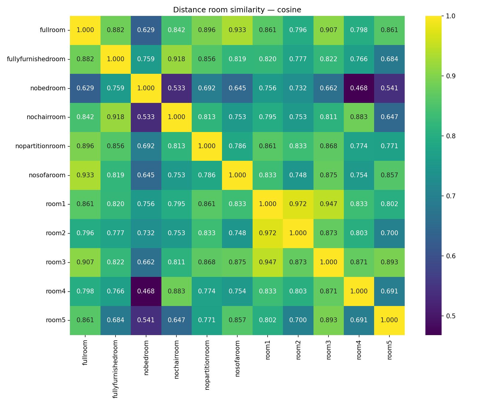

# Indoor Scene Representation & RF Modeling
### Internship research toward wireless digital twins

**Tanisha Jain · Python · Blender · Computer Vision · Sionna RT · Machine Learning**

How can room geometry and visual appearance describe an indoor environment—and how much of its simulated radio behavior can a learned model predict?

This repository brings together the coding work from my Airtel internship project: **visual scene embeddings, geometric scene similarity, RF simulation and surrogate learning, and Gaussian-splatting experiments**. It includes research code, original notebook variants, simulated room assets, and saved evaluation evidence.



*A fresh CPU replay of the original distance-matrix method using the supplied object-coordinate CSVs. Cosine similarity describes the chosen representation; it is not a measure of wireless prediction accuracy.*

## Explore the project

| Workstream | Approach | Start here |
| --- | --- | --- |
| Visual scene representation | CLIP and DINOv2 embeddings; multi-view room comparisons | [Visual experiments](notebooks/originals/clipdinoemb_(2)_export.ipynb) |
| Geometric scene representation | Object alignment, pairwise distances, Fourier coordinate encoding | [Runnable CPU replay](scripts/geometry_similarity.py) · [source notebook](notebooks/originals/fourier_export.ipynb) |
| RF surrogate baseline | 50 geometry/material/link features → 16 simulated RF descriptors | [Experiment pipeline](experiments/rf_surrogate/experiment.py) |
| Controlled RF follow-up | Separate prediction heads, feature engineering, diagnostics | [Follow-up code](experiments/rf_followup/followup.py) · [saved results](results/rf_followup) |
| WRF-GS+ adaptation | One-room directional RF-image prediction using the authors' model and renderer | [Pipeline](experiments/wrfgs_one_room/run_pipeline.py) · [recorded results](docs/WRFGS_RECORDED.md) |
| RF-3DGS exploration | Visual checkpoint initialization and RF spectrum reconstruction | [Original cleaned notebook](notebooks/originals/RF_3DGS.ipynb) |

For the focused optical 3DGS / RF-3DGS / WRF-GS+ notebook collection, see [my companion repository](https://github.com/tanisha-jain19/vision-and-rf-gaussian-splatting).

## Work included

- Blender room models, mesh exports, coordinate tables, and original rendered views.
- CLIP/DINOv2 and geometric similarity experiment notebooks, including distinct earlier versions.
- Simulation, feature extraction, training, evaluation, inference, and numerical-check code.
- Follow-up evaluation tables, predictions, diagnostics, plots, and the saved follow-up model.
- Fresh setup, methodology, result interpretation, provenance, and coverage documentation.

My contribution is the experiment implementation and integration around the credited research tools. Pretrained vision models and Gaussian-splatting algorithms belong to their original authors. This is a research portfolio, not an official Airtel product or a deployment-ready wireless digital twin.

## Run a complete CPU example

From the repository root, in a Python 3.11 or 3.12 environment:

```bash
python -m pip install -r requirements.txt
python scripts/geometry_similarity.py
```

This reads **11 room configurations with 8 aligned objects** and generates distance and Fourier similarity CSVs and heatmaps in `results/geometry_replay/`. It does not download models or require a GPU.

For the CUDA research workflows, follow [SETUP.md](docs/SETUP.md). Their environments are separate from this CPU example.

## Results, with the limits visible

### RF surrogate: historical held-out configuration results

The original fast model and follow-up use the same room family and test links. The follow-up is exploratory because the original test results were already known.

| Test measure | Original fast model | Follow-up |
| --- | ---: | ---: |
| Path-gain MAE (dB) ↓ | 2.6641 | 2.1873 |
| RMS-delay-spread MAE (ns) ↓ | 1.0676 | 1.2801 |
| Dominant-path-fraction MAE ↓ | 0.1019 | 0.0902 |
| Warm full-output prediction time (ms) ↓ | 19.15 | 60.96 |

The matched benchmark measured Sionna at **52.20 ms**. The follow-up improves gain/fraction MAE but worsens delay and runtime; **it is not an overall replacement for the baseline**. The predicted 80-D scene embeddings remain unreliable. See [results and evidence](docs/RESULTS.md).

### WRF-GS+: separately recorded one-room experiment

The saved experiment record reports **MAE 0.018261 / SSIM 0.862078** on 90 reserved transmitter positions, versus nearest-position copying at **0.020114 / 0.845950**. These are normalized RF-image metrics, not accuracy percentages or absolute received-power errors. The full checkpoint/test artifact archive is not present in the published files; these numbers are attributed to the saved record, not newly reproduced here.

## Validation for this publication

- CPU geometry replay completed successfully.
- **7 existing numerical tests passed** across the RF surrogate and WRF-GS+ math.
- Python files and notebook code passed syntax checks; notebooks passed schema validation.
- Recorded RF follow-up errors were checked against the saved per-query predictions.
- No new GPU training, Sionna simulation, or end-to-end CUDA reproduction was performed.

## Repository layout

```text
scripts/        Portable geometry replay, image inspection, upstream fetch helper
experiments/    RF baseline, controlled follow-up, WRF-GS+ adapter and scene meshes
notebooks/      Cleaned original experiment notebooks and variants
data/           Simulated Blender scenes, object CSVs, room views and original figures
results/        New CPU replay and saved historical RF follow-up evidence/model
docs/           Setup, methodology, results, coverage and provenance
```

Read [coverage and exclusions](docs/COVERAGE.md) for the exact public scope and [credits](THIRD_PARTY_NOTICES.md) for upstream attribution. Large external datasets, duplicate archives, personal paperwork, and private cloud links are not bundled.
